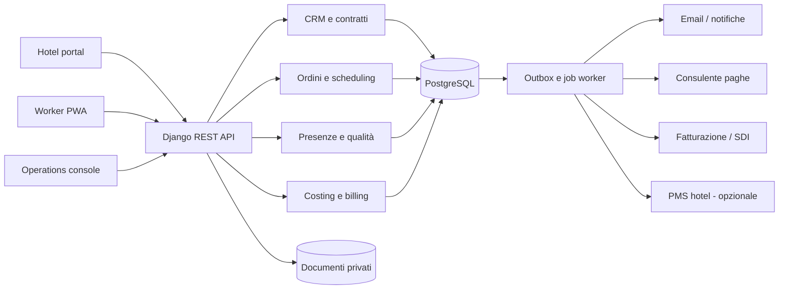
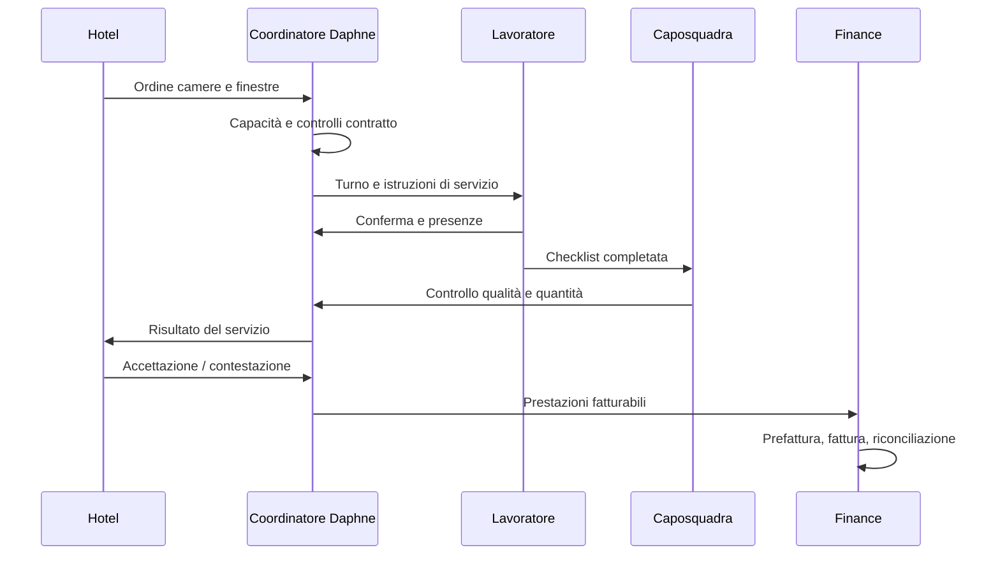

# Hospitality Operations Platform
## Specifica funzionale e tecnica — v1.0
**Daphne Solutions | MVP outsourcing alberghiero | 24 novembre 2026**

### 1. Obiettivo e perimetro
Gestire appalti di servizi alberghieri, dal preventivo all'incasso. Prima versione housekeeping; estensione a lavanderia, aree comuni e colazioni tramite catalogo configurabile. Il sistema è un ERP verticale di servizio, non un marketplace di personale. Il cliente ordina risultati e approva prestazioni; solo Daphne assegna, modifica e dirige i lavoratori. Un'eventuale partnership APL è un modulo separato di lead commerciali; nessun contratto di somministrazione o selezione per conto terzi emesso da Daphne.

### 2. Attori e autorizzazioni
| Ruolo | Permessi |
|---|---|
| Admin Daphne | Configurazione, utenti, contratti, report, audit |
| Commerciale | CRM, preventivi e rinnovi; nessun dato sanitario/paghe |
| HR | Anagrafiche, contratti, disponibilità, documenti, export paghe |
| Coordinatore | Ordini, capacità, turni, assegnazioni, eccezioni e approvazioni |
| Caposquadra | Squadra assegnata, checklist, qualità, incidenti, proposte sostituzione |
| Lavoratore | Propri turni, conferme, presenze, compiti e documenti personali |
| Hotel | Propri siti, ordini di servizio, volumi, risultati, contestazioni, fatture |
| Finance | Costi, fatture, crediti, incassi e riconciliazione |
| Consulente paghe | Export approvato e documenti strettamente necessari |

Accesso per organizzazione e sito, con deny by default. Hotel non può creare turni individuali, vedere salari, contatti privati o dati HR, autorizzare ferie, confermare chiamate o inviare comandi diretti ai lavoratori. Le contestazioni arrivano al coordinatore. Le istruzioni di sicurezza ed emergenza restano gestite secondo procedure concordate.

### 3. Architettura proposta
Stack scelto per integrazione con competenze esistenti: Django + Django REST Framework, PostgreSQL, Next.js App Router (portale web/PWA), eventuale Flutter solo dopo il pilota; storage S3 compatibile (R2), coda Celery/Redis o job database con outbox, hosting UE da verificare. Monolite modulare, non microservizi. Auth sessione sicura o OIDC, MFA per ruoli privilegiati. API versionata e OpenAPI. Tutte le integrazioni sono adattatori sostituibili.



### 4. Moduli funzionali e criteri di accettazione
| ID | Funzionalità | Regola di accettazione |
|---|---|---|
| CRM-01 | Lead, hotel, contatti, pipeline | Lead qualificato con sito e volume; storico cambi stato |
| CRM-02 | Preventivo versionato | Prezzi e costo stimato congelati alla proposta; revisione crea nuova versione |
| CTR-01 | Contratto e allegati SLA | Attivo solo con approvazione, date, listino e responsabile Daphne |
| CTR-02 | Listino per categoria e periodo | Nessuna sovrapposizione per servizio/sito; tariffa risolta alla data servizio |
| ORD-01 | Ordine giornaliero / ricorrente | Hotel indica servizio, quantità, finestre, priorità e sito; non nominativi |
| ORD-02 | Variazioni e cancellazioni | Dopo cutoff, richiesta motivata; coordinatore accetta o rifiuta; applica penale configurata |
| PLN-01 | Previsione capacità | Minuti standard × quantità, buffer, trasferimenti; evidenzia gap |
| PLN-02 | Turni e assegnazioni | Solo Daphne può assegnare; conflitti, formazione scaduta e indisponibilità bloccano |
| PLN-03 | Chiamata intermittente | Validazione HR, conferma lavoratore e comunicazione preventiva documentata prima dell'inizio |
| PLN-04 | Sostituzioni | Assenza genera task; nuova assegnazione conserva storico |
| WRK-01 | Agenda lavoratore | Solo propri turni e compiti; conferma o rifiuto se ammesso |
| WRK-02 | Check-in/out | Ora server, sito, eventuale codice QR; rettifica motivata e approvata |
| QA-01 | Checklist per camera/servizio | Versione checklist salvata su esecuzione; esiti e anomalie |
| QA-02 | Controllo qualità | Caposquadra registra campione, esito e rifacimento; hotel contesta risultato |
| QA-03 | Chiusura prestazione | Quantità accettata e scartata riconciliate; nessun doppio addebito |
| HR-01 | Fascicolo dipendente | Contratto, livello, competenze, scadenze, disponibilità; accessi limitati |
| HR-02 | Regole di lavoro | Limiti, riposi, sovrapposizioni, deroghe validate; log delle decisioni |
| PAY-01 | Export presenze | Solo ore approvate, codici causale, maggiorazioni e periodo; export versionato |
| FIN-01 | Costing | Ore effettive × costo versione, materiali, trasferte, allocazione fissi separata |
| FIN-02 | Prefattura | Solo quantità accettate non già fatturate, tariffa contrattuale e imposta validata |
| FIN-03 | Fatturazione | Invio idempotente all'adattatore; stato SDI e numero attribuiti dal sistema fiscale |
| FIN-04 | Crediti | Scadenze, pagamenti parziali, note credito, aging e riconciliazione |
| REP-01 | Dashboard commessa | Ricavi, costi, produttività, qualità, utilization, EBITDA proxy |
| REP-02 | Previsione cassa | 13 settimane con scadenze reali, payroll stimato, contributi e IVA separata |
| AUD-01 | Audit | Attore, evento, timestamp, oggetto, motivo, correlazione; immutabilità applicativa |

### 5. Flussi e state machine
**Preventivo:** draft → sent → accepted / rejected / expired. Accettazione non attiva automaticamente contratto se mancano allegati o approvazione. Contratto draft → approved → active → suspended / ended. Versioni immutable dopo attivazione; modifiche future tramite amendment.

**Ordine:** draft → submitted → accepted → planned → in_progress → delivered → quality_review → accepted_result → billable → invoiced. Rami: rejected, cancelled, disputed; contestazione apre ticket, accettazione parziale per righe consentita. Non confondere stato ordine con stato turno.

**Turno:** draft → offered (se applicabile) → confirmed → started → completed → approved → payroll_exported. Alternative declined, cancelled, no_show. L'export non cancella lo storico; rettifiche dopo chiusura generano record di aggiustamento approvato.

**Fattura:** draft → approved → submitted → accepted_by_provider / rejected → sent → paid_partial / paid. Stato fiscale e stato pagamento separati. Note credito riferite alle righe originali. Numero fiscale non inventato né riutilizzato dal gestionale. Retry con chiave idempotente e riconciliazione provider.



### 6. Modello dati relazionale
Tabelle UUID, created_at/updated_at UTC, timezone sito Europe/Rome, importi Decimal, quantità Decimal, durate in minuti. organization_id su tutte le entità di dominio. Vincoli FK, unique, check e transazioni. Non eliminare documenti fiscali o storici obbligatori; applicare retention per categoria.

| Entità | Campi principali e vincoli |
|---|---|
| Organization, Membership | legal_name, tax_id, role, active; unique user/org/role |
| Client, Site | client_id, billing profile, address, timezone, credit_limit |
| Lead, Quote, QuoteLine | stage, valid_until, version, expected_qty, unit_price, estimated_cost |
| ServiceCatalog, SLA | unit, standard_minutes, checklist_template, acceptance_window, quality_target |
| Contract, ContractVersion | client, site, valid_from/to, status, owner, minimum_charge, payment_terms, cutoff, signature_ref |
| RateCardLine | contract_version, service, variant, validity, amount, VAT rule; no overlapping effective dates |
| Worker, EmploymentContract | HR id, employer, type, dates, CCNL, level, availability_obligation, verified_ruleset |
| WorkerCostVersion | valid_from/to, hourly_cost, currency, contribution assumptions, source/payroll ref |
| Qualification, WorkerQualification | type, expiry, status, evidence; health data limited to fitness status if necessary |
| Availability, Absence | worker, start/end, status, restricted reason |
| ServiceOrder, OrderLine | site, contract_version, service_date, quantity, deadline, accepted_qty, status |
| WorkUnit | order_line, opaque room_ref, variant, estimated_minutes, completion status |
| Shift, Assignment | worker, site, start/end, supervisor, assignment status, rule_check_id; prevent overlapping active shifts |
| CallNotice | assignment, worker confirmation, submission timestamp, external receipt, status |
| AttendanceEvent, Timesheet | source, timestamp, type, approved_minutes, revision, approver |
| ChecklistTemplate, ChecklistRun | version, work_unit, responses, completion timestamp |
| Inspection, Incident, Dispute | severity, owner, state, due_at, outcome; separate restricted incident storage |
| ServiceAcceptance | order_line, accepted_qty, rejected_qty, approver, version, evidence |
| CostEntry | cost_type, order/site, quantity, rate_snapshot, amount, currency, source |
| PayrollBatch, PayrollLine | period, worker, code, minutes, export_hash, version, external_ref |
| BillingBatch, Invoice, InvoiceLine | contract, service_period, status, external_id, tax_rule_snapshot, total; unique billing source allocation |
| Payment, PaymentAllocation | bank_ref, amount, date, invoice_id; sum allocations ≤ payment |
| Document, AuditEvent, OutboxEvent | private key, classification, retention; event UUID, idempotency key, retry count |

Partial invoicing requires allocation table with quantity reserved/issued/credited, unique idempotency key per source and batch. A credit note releases quantity only according to approved commercial adjustment, not automatically. Attendance corrections use append-only revisions with reason and approver. No raw guest names, room occupant details or health diagnoses in operational schema.

### 7. Scheduling e algoritmo
Input: orders accettati, standard_minutes, finestre servizio, vincoli sito, capacità, disponibilità, competenze, contratti validi, rest periods, trasferimenti, responsabile. Passo 1: stima capacità per sito e fascia temporale. Passo 2: filtra candidati legalmente e operativamente idonei. Passo 3: assegna minimizzando scoperture, costo incrementale, spostamenti e discontinuità; tie-break deterministico. Passo 4: coordinatore approva o modifica, con motivazione. MVP greedy con ordinamento per deadline e skill; fase 2 OR-Tools se i volumi lo giustificano. Vincoli legali non sovrascrivibili da un semplice admin; deroghe solo con regola validata da HR. Per intermittenti nessun turno operativo senza conferma ove necessaria e ricevuta della comunicazione preventiva quando dovuta. Non classificare lavoratori con modelli opachi o automatizzare sanzioni.

Esempio: 30 checkout × 40 minuti + 20 stayover × 25 minuti = 1.700 minuti; con buffer 10% = 1.870 minuti. Quattro persone con 480 minuti disponibili forniscono 1.920 minuti, prima di ulteriori vincoli e spostamenti. Il sistema mostra copertura teorica, non garantisce che tutte le finestre siano fattibili.

### 8. API REST
Tutte le mutation POST/PATCH sensibili richiedono autorizzazione per oggetto, audit e controllo versione (If-Match o version). Idempotency-Key per comandi, billing e import. Pagination cursor, errori machine-readable (code, detail, fields, correlation_id), timestamp ISO 8601.

| Metodo e path /api/v1 | Funzione |
|---|---|
| POST /clients, /sites, /quotes | CRM e preventivi |
| POST /quotes/{id}/send, /accept | Transizioni preventivo |
| POST /contracts/{id}/activate | Verifica prerequisiti |
| POST /orders | Ordine di risultato da hotel |
| POST /orders/{id}/accept | Accettazione Daphne |
| POST /orders/{id}/change-requests | Variazioni cliente |
| POST /planning/runs | Proposta turni e gap |
| POST /planning/runs/{id}/approve | Applica piano atomico |
| POST /assignments/{id}/confirm | Conferma lavoratore |
| POST /assignments/{id}/replace | Sostituzione Daphne |
| POST /assignments/{id}/call-notices | Registra comunicazione e prova |
| POST /attendance/events | Evento presenza idempotente |
| POST /timesheets/{id}/approve | Approvazione presenze |
| POST /work-units/{id}/complete | Checklist esecuzione |
| POST /work-units/{id}/inspections | Controllo qualità |
| POST /order-lines/{id}/acceptances | Accettazione quantità |
| POST /disputes | Contestazione servizio |
| POST /payroll-batches | Genera export |
| POST /billing-batches | Genera prefatture |
| POST /invoices/{id}/submit | Invio fiscale tramite adapter |
| POST /integrations/invoicing/webhook | Ricezione stato provider, firma verificata |
| POST /payments/import | Import movimenti e deduplica |
| GET /reports/site-profitability | Margine per sito e periodo |
| GET /reports/cash-forecast | Forecast cassa |

Esempio payload ordine:
```json
{"site_id":"uuid","service_date":"2027-01-15","lines":[{"service_code":"ROOM_CHECKOUT","quantity":20,"window_start":"09:00","window_end":"14:00","variant":"STANDARD"}],"external_reference":"HOTEL-20270115"}
```
Rifiutare campi worker_id o shift_id su ordine cliente. Codici errore: CONTRACT_INACTIVE, RATE_NOT_FOUND, CAPACITY_GAP, SHIFT_OVERLAP, QUALIFICATION_EXPIRED, CALL_NOTICE_REQUIRED, ACCEPTANCE_EXCEEDS_DELIVERY, ALREADY_BILLED, VERSION_CONFLICT. Il gap capacità può produrre proposta non approvabile, non un errore distruttivo.

### 9. Interfacce e notifiche
Back office: dashboard con richieste, turni scoperti, incassi e margini; calendario drag/drop con validazione server; scheda hotel con SLA e listino; scheda contratto; CRM pipeline; vista qualità; vista payroll e billing. Portale hotel: calendario ordini, volumi, stato, contestazioni e documenti fiscali. PWA lavoratore: oggi, prossimi turni, conferma/rifiuto, check-in, checklist, segnalazioni e documenti propri. Caposquadra: lista camere, qualità, eccezioni e sostituzioni richieste. UX mobile-first, italiano, in seguito francese/inglese.

Notifiche: nuovo turno, promemoria, rifiuto, assenza, scadenza formazione, ordine modificato, mancata copertura, fattura scaduta. Nessun dato sensibile in push/SMS. Email transazionali inizialmente; WhatsApp Business solo con template, consensi/base giuridica e verifica provider. Offline: cache minima di compiti, queue con event_uuid e sync; presenza offline marcata non verificata, da approvare. QR sito non prova da solo identità o presenza; nessun GPS continuo o biometria nel MVP.

### 10. Costing, paghe e fatturazione
Separare ore contrattuali, pianificate, effettive, approvate e imputate. CostEntry basato su costo orario fully loaded versione valida e minuti approvati, più materiali, trasferta, alloggio, rifacimenti; fissi allocati separatamente con driver dichiarato. Margine diretto = ricavi maturati − costi diretti. Report di margine operativo = margine diretto − fissi allocati − perdite crediti stimate. Ricavi maturati distinti da ricavi fatturati e incassati. Eventuale tariffa oraria serve a costing o specifici contratti validati, non implica gestione dei lavoratori dal cliente.

Payroll: non calcolare cedolini in house. CSV/adapter per consulente paghe con identificativo, periodo, ore ordinarie, straordinarie, notturne/festive e assenze secondo mapping validato; rettifiche e acknowledgment. Regole maggiorazioni e CCNL versionate e confermate. Fatturazione: adapter per Fatture in Cloud o altro provider SDI; mappare causali IVA, reverse charge e natura dopo validazione fiscale, non inferirle dal nome servizio. Generare prefattura con quantità accettate e minimi contrattuali. Minimo mensile come riga differenziale, evitare doppio conteggio. Round per riga e verifica totale secondo provider. Riconciliare fatture con esiti SDI, note credito e incassi; mai ritentare cieco dopo timeout.

### 11. Sicurezza, privacy e qualità tecnica
GDPR: definire titolare/responsabili per ogni trattamento, informative lavoratori e clienti, registro trattamenti, DPA fornitori, retention e procedure diritti. Valutare art. 4 Statuto lavoratori prima di strumenti di controllo, geolocalizzazione o analytics individuale; non introdurre sorveglianza continua. Accessi minimi, MFA per admin/finance, TLS, cifratura storage, URL firmati brevi, segreti in vault, logging senza dati riservati. RLS PostgreSQL come difesa aggiuntiva e test di isolamento; autorizzazione server per ogni richiesta. Backup giornaliero cifrato e restore testato; target proposti RPO 24h, RTO 8h, disponibilità 99,5%, p95 API 500 ms su carico pilota (esclusi job esterni). Monitoraggio Sentry, metriche coda, errori integrazione e alert. Audit log append-only a livello applicativo, protezione separata e accesso amministrativo ristretto. Conservazione secondo obblighi legali e policy da validare. Accessibilità WCAG 2.1 AA come target.

### 12. Test di accettazione e rilascio
| Test | Esito atteso |
|---|---|
| Hotel A prova a leggere ordine B | 403/404, nessuna fuga dati |
| Hotel prova ad assegnare un dipendente | 403, evento audit appropriato |
| Due turni sovrapposti in richieste concorrenti | Uno solo confermato, conflitto atomico |
| Intermittente senza adempimento obbligatorio | Blocco prima dell'inizio |
| Formazione scaduta | Assegnazione bloccata |
| Cambio ora legale | Durata calcolata su UTC, visualizzazione locale corretta |
| Evento offline inviato due volte | Una sola presenza |
| Quantità accettata > completata | Rifiuto validazione |
| Due batch fatturano stessa prestazione | Nessuna doppia fattura |
| Timeout provider dopo invio | Stato in riconciliazione, niente duplicato |
| Nota credito parziale | Allocazione e saldi coerenti |
| Rettifica dopo export paghe | Nuova revisione, storico preservato |
| Backup ripristinato | Dati e permessi verificati |

### 13. Roadmap di implementazione
Sprint 0: mappare processo reale, contratti, regole HR e formati export; setup repo, CI, ambienti e fixtures. Sprint 1: auth, tenant, clienti, siti, catalogo, contratti/listini, ordini. Sprint 2: turni, disponibilità, controllo regole e PWA. Sprint 3: qualità, presenze, costing. Sprint 4: payroll CSV, prefattura, export fatture e report. Sprint 5: hardening, UAT e pilota. Iniziare con import PMS manuale CSV, poi adapter per sistemi scelti dai primi hotel; nessuna API PMS o provider è stata verificata. Stima preliminare 15–30 giornate per MVP molto ridotto con componenti riusabili; versione completa con integrazioni, sicurezza e workflow avanzati può richiedere significativamente di più. Non è un preventivo vincolante.

Definition of done: migration reversibile/testata, OpenAPI aggiornata, test unitari e integrazione, controllo accessi, audit, manuale operativo, deployment staging, UAT con hotel e consulente paghe, piano rollback. Nessuna feature HR automatica va in produzione senza validazione professionale.

### 14. Decisioni aperte
CCNL/livelli, forma societaria, regole intermittente, aliquote IVA per servizio, fornitore paghe, formato fatture, PMS dei clienti, gestione alloggio e trasporto, retention, eventuale app mobile, policy per contestazioni e accettazione tacita, condizioni partner APL. Queste sono configurazioni e verifiche da chiudere prima di sviluppare o attivare le rispettive funzioni. Il documento è una specifica proposta, non codice implementato né integrazione già testata.
